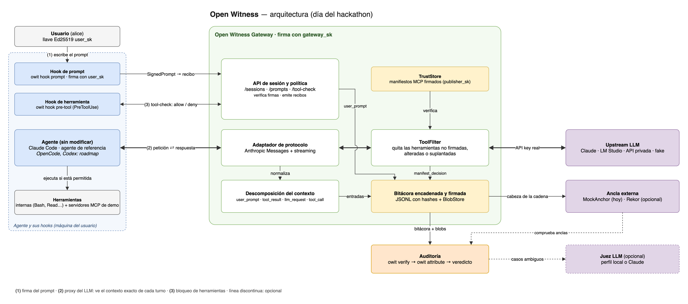

## Defensa

<!-- Responsable: Juliana (SPEC §13.3). Andres lo ensambla en docs/ficha_tecnica.md. Fuentes: SPEC §1, §5, §6, §7.9.
     Al ensamblar en docs/ficha_tecnica.md, la ruta de la imagen pasa a ser img/arquitectura.png. -->

Open Witness es un **gateway entre el agente y su LLM**. No modifica el agente: Claude Code se redirige con `ANTHROPIC_BASE_URL` y recibe solo un token de sesión, nunca la API key real.

Cada sesión deja evidencia criptográfica de tres cosas:

1. **Qué pidió el usuario.** Un hook del agente firma cada prompt con la llave Ed25519 del usuario, con nonce contra repeticiones y revocación con fecha. El gateway lo registra y devuelve un **recibo firmado**, que el usuario conserva.
2. **Qué herramientas vio el modelo.** Cada herramienta MCP se compara con un **manifiesto firmado por su publicador**. Si no tiene firma, la firma no es válida, la llave no es de confianza, la descripción cambió después de firmar, la versión nueva viene con otra llave (*rug pull*) o el nombre es de otro servidor (*shadowing*), el gateway la **quita de la petición**: el modelo nunca la ve. Si aun así la llama, el hook `PreToolUse` la deniega.
3. **Qué había en el contexto.** El gateway descompone cada petición en una **bitácora encadenada por hashes**, firmada y anclada a un sello externo. Cada entrada guarda su origen: usuario, herramienta, modelo o el propio agente.

**Atribución.** Ante un incidente, el verificador primero comprueba la integridad de la bitácora (determinista) y después atribuye la acción con reglas: `USER_INSTRUCTED` o `TOOL_INJECTED(Z)`, de dónde salió cada argumento y si hay **no repudio** (prompt firmado).

Las firmas llevan una etiqueta de dominio por tipo (prompt, manifiesto, bitácora, recibo, ancla), así que una firma no sirve como otra. La criptografía prueba *qué vio el modelo y quién firmó cada parte*, no *por qué decidió actuar*.
