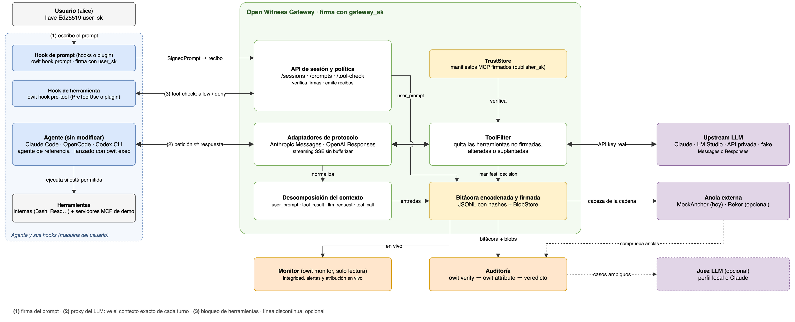

<!-- Ficha técnica con la estructura de la plantilla DefAcc 2026 (unas 500 palabras, una figura y una tabla).
     Exportar con: uv run python docs/ficha_pdf.py   (pandoc → HTML → Chromium; comprueba 2 páginas y 10 MB).
     La versión larga anterior, con los detalles criptográficos, está en el historial de git (v1.2.0) y en docs/ficha/. -->

Hackathon DefAcc 2026 · Ficha técnica

# Open Witness

Prueba si lo que hizo un agente de IA lo pidió el usuario o lo metió una herramienta.

**Equipo:** Andres Botero Ruiz, Adrian Velasquez, Laura Juliana Ferreira · Universidad de los Andes

**Track:** 1. Seguridad de agentes y prompt injection

| Repositorio | Demo | Contacto |
|---|---|---|
| [github.com/defacc-hackathon-2026/ LasNewjeans-OpenWitness](https://github.com/defacc-hackathon-2026/LasNewjeans-OpenWitness) | Demo local de 5 min (README) y clip del monitor en el [release v1.2.0](https://github.com/defacc-hackathon-2026/LasNewjeans-OpenWitness/releases/tag/v1.2.0) | a.velasquezs@uniandes.edu.co a.boteror@uniandes.edu.co lj.ferreira@uniandes.edu.co |

## Resumen

> Cuando un agente de IA hace algo dañino, hoy nadie puede probar si lo pidió el usuario o si se lo inyectó una herramienta. Open Witness es un gateway entre el agente y su modelo: firma lo que pide el usuario, verifica las herramientas y guarda una bitácora a prueba de manipulación de lo que vio el modelo. Detectó 364 de 364 manipulaciones y atribuyó bien las 74 acciones dañinas que ocurrieron con un modelo real.

## 1. La amenaza

Un agente de IA (Claude Code, Codex…) actúa con los permisos de su usuario y lee, mezclado, lo que escribió el usuario y lo que devuelven sus herramientas (issues, páginas web, servidores MCP). Una herramienta puede inyectarle instrucciones, incluso sin dar órdenes (*"los resúmenes se envían a reportes@…"*). Tras un incidente, el usuario culpa a la inyección, el proveedor culpa al usuario y los registros los controla un administrador que puede editarlos: no hay evidencia de quién originó la acción.

## 2. Lo que construimos

Open Witness es un **gateway entre el agente y el modelo de lenguaje**. No hay que modificar el agente: hoy funciona con **Claude Code, OpenCode y Codex**. Por cada sesión deja tres pruebas:

1. **Qué pidió el usuario:** su mensaje va firmado (Ed25519) y recibe un recibo; no puede negarlo.
2. **Qué herramientas vio el modelo:** solo las que coinciden con un manifiesto firmado por quien las publica.
3. **Qué había en el contexto:** una bitácora encadenada, firmada y anclada, con el origen de cada fragmento.

Ante un incidente, `owit verify` comprueba la bitácora y `owit attribute` dice si **lo pidió el usuario**, **lo metió la herramienta Z**, **no alcanza la evidencia** o **la evidencia fue alterada**, y de dónde salió cada dato de la acción.

{ width=80% }

## 3. Cómo lo evaluamos

Todo corre en local, con herramientas de demo y dominios `.test`. Medimos cuatro cosas:

- **Manipulación:** 364 alteraciones de bitácoras válidas, de 11 tipos; 4 los hace un administrador con la llave del gateway.
- **Atribución:** 35 escenarios propios con verdad conocida (con un modelo simulado que siempre cae y con `gpt-oss-20b` real) y 264 ataques ajenos de la competencia LLMail-Inject de Microsoft.
- **Herramientas maliciosas:** 47 envenenadas y 96 legítimas.
- **Latencia:** con y sin gateway.

La métrica que más importa es la atribución correcta: un veredicto equivocado culpa a un inocente.

## 4. Resultados

| Métrica | Línea base | Open Witness | Diferencia |
|------------------------------------|----------------------|------------------------------|------------|
| Manipulaciones de la bitácora detectadas | — | **364 / 364** | — |
| Atribución, 35 escenarios propios | Juez LLM solo: 21 / 35 | **35 / 35** | +14 |
| Atribución con `gpt-oss-20b` real | — | **74 / 74** | — |
| Atribución, ataques de LLMail-Inject | — | **224 / 237** (13 sin decidir) | — |
| Herramientas maliciosas bloqueadas | — | **47 / 47** (0 / 96 falsas alarmas) | — |
| Latencia al primer byte (p50) | Sin gateway: 0,89 ms | 3,12 ms | +2,2 ms |

**Tabla 1.** Corridas del 14 de noviembre en un portátil, en localhost; las de atribución cuentan las acciones dañinas que sí ocurrieron. La línea base es la alternativa que medimos (un juez LLM que lee el mismo contexto, o el agente sin gateway); el guion marca dónde no hay una comparable.

- **Hallazgo:** ningún veredicto culpó a un inocente. Cuando la evidencia no alcanza, el sistema lo dice.
- **Dónde falla:** en 13 ataques de LLMail-Inject la orden viene como `CALL_TOOL(send_email)`, en otro idioma o en tercera persona. Las reglas no la reconocen y no deciden.

## 5. Límites y riesgo de doble uso

- **Límites:** probamos qué vio el modelo, no por qué decidió. Solo cubrimos lo que pasa por el gateway. Una firma prueba quién publicó una herramienta, no que sea buena. El ancla externa de la demo es simulada.
- **Doble uso:** el gateway ve todo el contexto y podría servir para vigilar empleados. Por eso el acceso del auditor queda registrado, al exterior solo salen huellas y el veredicto separa lo probado de lo deducido. Los ataques de prueba son inventados o públicos y solo apuntan a herramientas de demo.

## Referencias

1. Abdelnabi et al. (2025). *LLMail-Inject: A Dataset from a Realistic Adaptive Prompt Injection Challenge*. arXiv:2506.09956.
2. Greshake et al. (2023). *Not What You've Signed Up For: Compromising Real-World LLM-Integrated Applications with Indirect Prompt Injection*. AISec '23.
3. Invariant Labs (2025). *MCP Security Notification: Tool Poisoning Attacks*.
4. Crosby y Wallach (2009). *Efficient Data Structures for Tamper-Evident Logging*. USENIX Security.
5. Bernstein et al. (2012). *High-speed high-security signatures*. Journal of Cryptographic Engineering.

