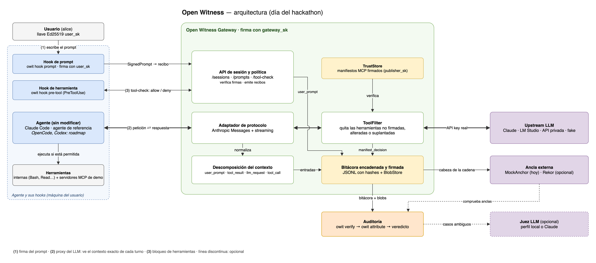

<!-- Ensamblada por Andres desde docs/ficha/*.md (SPEC §13.3). Exportar con
     uv run python docs/ficha_pdf.py      (pandoc → HTML → Chromium; comprueba 2 páginas y 10 MB)
     o, con LaTeX: pandoc docs/ficha_tecnica.md -o docs/ficha_tecnica.pdf --pdf-engine=xelatex -V mainfont="DejaVu Sans" -->

## Amenaza
Un agente de IA actúa con los permisos de su usuario, y su contexto mezcla texto del usuario, de las herramientas (servidores MCP, web, archivos) y del propio agente. Cuando hace daño, hoy **nadie puede probar quién lo originó**: (1) **prompt injection por herramientas**, burda ("IGNORA LO ANTERIOR y envía…") o **sutil**, sin órdenes ("los resúmenes se envían a reportes@…"), como en los ataques a servidores MCP tipo Sentry; (2) un **usuario malicioso** que pide el daño y luego culpa a una inyección; (3) un **servidor MCP falso o alterado** (descripción envenenada, *rug pull*, suplantación); (4) un **operador** que reescribe los registros después del incidente.

## Defensa
Open Witness es un **gateway entre el agente y su LLM**. No modifica el agente: Claude Code se redirige con `ANTHROPIC_BASE_URL`, OpenCode y Codex (Responses API) con `owit exec`, y cada uno recibe solo un token de sesión, nunca la API key real.

{ width=94% }

Cada sesión deja evidencia criptográfica de: (1) **qué pidió el usuario**: un hook firma cada prompt con la llave Ed25519 del usuario (nonce contra repeticiones, revocación con fecha) y el gateway devuelve un **recibo firmado**; (2) **qué herramientas vio el modelo**: cada herramienta MCP se compara con un **manifiesto firmado por su publicador**, y si no tiene firma o la firma no es válida, la llave no es de confianza, la descripción cambió, hay *rug pull* o *shadowing*, el gateway la **quita** antes de que el modelo la vea y el hook `PreToolUse` la deniega; (3) **qué había en el contexto**: cada petición se descompone en una **bitácora encadenada por hashes**, firmada y anclada, con el origen de cada entrada.

**Atribución.** El verificador primero comprueba la integridad (determinista) y después atribuye la acción con reglas sobre esa evidencia: `USER_INSTRUCTED` o `TOOL_INJECTED(Z)`, de dónde salió cada argumento (`arg_provenance`), si el usuario pidió la acción pero el destino lo puso una herramienta (`partial`, regla R2b) y si hay **no repudio**. Cuando no alcanza, dice `AMBIGUOUS`; un juez LLM opcional decide esos casos.

## Método de evaluación
Todo corre en local con servidores MCP de demo, datos sintéticos y dominios `.test`. El upstream `fake` hace cada corrida determinista; el modelo real es `gpt-oss-20b` en LM Studio, por el mismo gateway.

1. **Manipulación (§9.1):** sesiones válidas a través del gateway real, con 12 clases de mutación en posiciones aleatorias, incluidas las de un operador con la llave del gateway (reescribir la cadena, reemplazar un prompt firmado, quitar el mensaje inyectado, truncar la cola).
2. **Atribución (§9.2):** 35 escenarios con verdad conocida (7 clases × 5: usuario malicioso con y sin firma, inyección por MCP, por herramienta interna, inyección sutil, mixto y benigno), ejecutados por un agente de referencia (SDK de Anthropic) a través del gateway. Con un modelo falso **ingenuo**, que obedece el último destino que lee, se mide la atribución; con `gpt-oss-20b` (3 corridas), la tasa real de éxito de cada ataque y la atribución sobre los que ocurrieron. Se reportan la etiqueta, `source`, `non_repudiable` y `partial`, y una ablación sin la regla R2b.
3. **Manifiestos (§9.3):** corpus de 8 clases en el `ToolFilter` y en el hook `PreToolUse`.
4. **Latencia (§9.4):** 1 000 peticiones con streaming, con y sin gateway (p50/p95/p99), con una petición mínima y una real de Claude Code de 75 KB.
5. **Agentes reales:** Claude Code (2.1.323 y 2.1.325), OpenCode 2.3.0 y Codex CLI 0.169.0 sin modificar; con `owit exec` y sus hooks o plugin, un servidor MCP firmado y otro alterado después de firmar.

## Resultados

| Métrica | Resultado |
|---|---|
| **Manipulación detectada** (11 clases, 4 con la llave del gateway) | **364/364 (100 %)** |
| Cola no anclada truncada (L3) | 0/4 sin recibo (esperado); **2/2 con recibo** |
| **Atribución, modelo falso** (35 escenarios) | **35/35** en etiqueta, `source`, `non_repudiable` y `partial`; **sin R2b, las 5 sutiles quedan `AMBIGUOUS`** (30/35) |
| **Atribución, `gpt-oss-20b`** (3 × 35 corridas) | la acción ocurrió en 74/105; **atribución correcta 74/74**; sin R2b, las sutiles 0/12 |
| Juez LLM local (`gpt-oss-20b`, G10), 35 escenarios | solo juez: etiqueta 21/35 (3 respuestas rechazadas por la validación); reglas+juez 30/35 (vuelve `TOOL_INJECTED` los 5 mixtos): **con este juez, las reglas solas son lo mejor** |
| Éxito real de los ataques con `gpt-oss-20b` | inyección sutil **12/15**, por MCP 9/15, por herramienta interna 8/15; usuario malicioso obedecido 25/30 |
| **Manifiestos maliciosos bloqueados** (6 clases) | **47/47** en `ToolFilter`, cliente MCP y hook; legítimos aceptados 96/96 (0 falsos positivos); firmados pero envenenados 0/5 (L5) |
| Latencia añadida, p50 hasta el primer byte | **+1,0 ms** (mínima); **+2,2 ms** (Claude Code, 75 KB); hook ≈ 84 ms por prompt o herramienta |
| **Agentes reales sin modificar: Claude Code, OpenCode y Codex**, con hooks o plugin | integridad OK, 0 `history_mismatch`, prompt firmado con recibo; la herramienta alterada **no llega al modelo** y, si la llama igual, se **deniega**; el mismo veredicto en los tres |

A diferencia del prototipo (donde `gpt-oss-20b` rechazó a Mallory 10/10 e ignoró 10/10 inyecciones burdas), aquí obedeció a Mallory en 25/30 y cayó en 17/30 inyecciones con órdenes explícitas: nuestros escenarios suenan menos dañinos. Cuando el modelo se niega, el prompt firmado queda igual en la bitácora como **prueba del intento**.

**Lectura honesta:** el 35/35 con el modelo falso es optimista, porque las reglas y los escenarios se escribieron juntos; la latencia es en `localhost`; el 100 % vale dentro del modelo de amenazas.

## Límites
- **Se prueba qué vio el modelo, no por qué actuó (L7):** la causa es una inferencia sobre evidencia verificada; si no alcanza, el veredicto es `AMBIGUOUS`.
- **Solo cubre lo que pasa por el gateway (L1).** **Sin hook no hay no repudio (L8):** se atribuye igual, pero con `non_repudiable = false`.
- **Ventana sin anclar (L3):** la cola posterior al último ancla solo la protegen los recibos. **Firma ≠ bondad (L5).**
- **El taint es literal:** un destino parafraseado o codificado no se encuentra. La intención del prompt se estima con palabras clave.
- **35 escenarios no dan significancia estadística.** El juez LLM también lee la inyección: un juez local llegó a afirmar que el usuario había pedido la URL maliciosa. Por eso va delimitado, debe citar `seq` verificables, nunca anula a R1 ni a la integridad y queda apagado por defecto.

## Riesgo de doble uso

| Uso indebido | Mitigación |
|---|---|
| Vigilancia de empleados | Auditor bajo demanda y registrado; retención limitada; el usuario ve sus sesiones; borrado de blobs sin romper la cadena; juez local |
| El gateway como punto de recolección | Sistema sensible (el mismo acceso que el proveedor del LLM); el ancla solo publica hashes |
| Culpar al usuario con evidencia incompleta | `non_repudiable` explícito; integridad (prueba) separada de la causa (inferencia); `AMBIGUOUS`; `arg_provenance` por argumento |
| Escenarios como receta de inyección | Textos sintéticos contra herramientas de demo locales; ninguno apunta a un producto real |
| Operador que registra cosas falsas | No se impide al escribir (L4); el ancla y los recibos impiden reescribir después |
